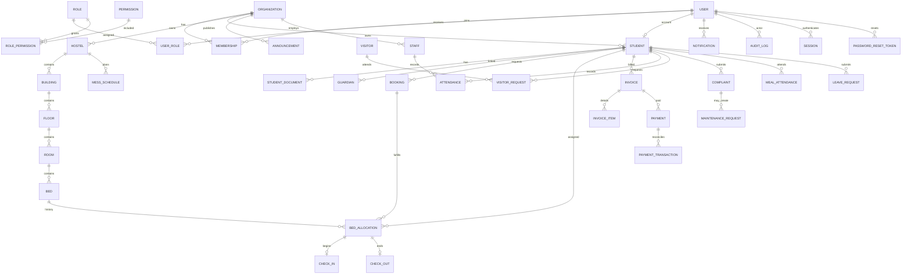

# Database Design Plan (Phase 0)

Use PostgreSQL through Prisma with normalized relational entities, UUID primary keys, `timestamptz` timestamps stored in UTC, and explicit organization ownership. Display timestamps in the configured organization/user timezone. Use Prisma `Decimal` / PostgreSQL `numeric(p,s)` for money, never floating point. Store provider currency codes alongside amounts.

## Entity relationship plan

## Tables and ownership

- **Organization, User, Role, Permission, UserRole**: organizations are tenants; users may participate in multiple organizations. Model role assignment with organization scope and optional hostel scope (membership/role-assignment join), rather than assuming one global role per user. Super-admin access is a distinct platform scope. Seed role definitions without public/default credentials.
- **Hostel, Building, Floor, Room, Bed**: ownership chain organization -> hostel -> building -> floor -> room -> bed. Hostels use `archivedAt` soft archiving so historical allocations and dependent operational records retain valid references. Add scoped unique identifiers (e.g. organization slug, hostel code within organization, building name within hostel, floor number within building, room number within floor, bed label within room). Capacity is derived from bed records or kept transactionally consistent.
- **Student, StudentDocument, Guardian, Staff**: student belongs to one organization and may have linked user account, educational institution/program/year, descriptive status (`ACTIVE`, `INACTIVE`, `SUSPENDED`, `GRADUATED`), guardians, and private documents. Status is distinct from archival and currently does not control account access or allocations. Staff links to user and authorized organization/hostel assignments. Keep sensitive document metadata/private object key separate from public URLs.
- **Booking, BedAllocation, CheckIn, CheckOut**: preserve history; state transitions and active date intervals are explicit. Enforce no overlapping active allocation for the same bed and no simultaneous active allocation for a student, using PostgreSQL exclusion/partial unique constraints (add SQL migration where Prisma schema syntax cannot express it). Serialize or lock competing allocation operations and transact occupancy/booking state changes.
- **Invoice, InvoiceItem, Payment, PaymentTransaction**: invoice has itemized decimal amounts, due date, status, and organization/student scope. Payments record amount/currency/method/status and actor. Transactions store provider reference, idempotency key, verification result, and timestamps; only trusted backend reconciliation updates paid state. Cash records require authorized actor/audit event.
- **Attendance, Visitor, VisitorRequest, Complaint, MaintenanceRequest, MessSchedule, MealAttendance, Notification, Announcement, LeaveRequest**: each operational record includes organization scope, parent relations, status/creation/update timestamps, and relevant actor/assignee relations. Validate that all linked records resolve within the same tenant.
- **AuditLog, PasswordResetToken, Session**: append-only audit records with actor/action/resource/tenant and redacted metadata; one-way hashed reset/session secrets, expiry, consumption/revocation timestamps. Sessions also track `lastSeenAt` for server-enforced idle timeout. Never store raw bearer/reset secrets.

## Booking and allocation date rules

- Booking `requestedFrom` and `requestedUntil` are organization-local calendar dates in the organization's IANA timezone. The start date is inclusive and the end date is exclusive; a `null` end means no planned end. Reject an end date that is on or before the start date.
- When a booking is approved into an allocation, convert each date boundary to the start of that local calendar day and store it as a UTC instant in `startsAt` / `endsAt`. Keep the original booking dates as submitted. This preserves local date intent across daylight-saving transitions.
- Allocation intervals use half-open semantics: `[startsAt, endsAt)`. Adjacent allocations may meet at the same instant without overlapping. Two active allocations conflict when `existing.startsAt < requestedEnd` and `existing.endsAt > requestedStart`; a missing end is unbounded.
- Apply the overlap rule independently to a student and a bed. Only `ACTIVE` allocations with no `endedAt` reserve intervals. `COMPLETED` and `CANCELLED` allocations remain in history and do not reserve future intervals. A recorded early checkout sets `endedAt` and releases the remaining interval; subsequent occupancy reads must use the effective end, not the original planned end.
- `CheckIn` / `CheckOut` timestamps are actual event instants in UTC. They do not change the requested calendar dates; checkout closes the effective allocation interval at its actual time.
- PostgreSQL exclusion constraints over half-open `tstzrange` intervals enforce non-overlap independently for each bed and student, scoped to active, non-ended allocations. The migration enables `btree_gist`; the database integration script checks overlap rejection, adjacency acceptance, and cancelled-history behavior. Review the extension permission and migration rollback/recovery plan before applying to production.

## Financial invariants

- Invoice amounts and payment amounts use PostgreSQL `numeric` / Prisma `Decimal`; convert validated decimal strings to fixed-scale decimal values and never calculate money with JavaScript floating-point arithmetic. Invoice line amount is quantity multiplied by unit amount, rounded to the currency's supported minor-unit scale; the invoice total is the sum of those persisted line amounts.
- Each invoice copies the organization's ISO 4217 currency at creation. Every payment must use the invoice currency; do not silently convert currencies. Reject non-positive amounts, over-precision values, and payment totals above the invoice balance.
- `DRAFT` invoices are editable and not payable. Issuing snapshots the itemized charges, total, currency, issue time, and due time; issued invoices are immutable except for status derived from verified payments. `VOID` is allowed only before any successful payment. `PAID` and `PARTIALLY_PAID` are derived from successful, non-refunded payment totals; `OVERDUE` is derived from an unpaid balance past due time.
- Cash and bank-transfer entries are recorded as `PENDING` until an authorized actor confirms receipt; only verified `SUCCEEDED` payments reduce the invoice balance. Provider callbacks must be signature-verified, idempotent by provider event/key, and safe to replay. A client-supplied success flag or payment status never reconciles an invoice.
- Every financial mutation is tenant-scoped through the student's active organization, records the authenticated actor, runs balance/status updates transactionally, and emits a redacted audit event. Refunds and reversals retain the original payment and transaction history rather than deleting or rewriting it.

## Integrity, indexes, delete policy

- UUID PKs; FKs on all relations; index tenant keys and common filters (`organizationId`, `hostelId`, status, createdAt, dueAt, studentId, roomId/bedId). Add compound indexes matching real list queries after query plans are measured.
- Unique constraints are tenant-scoped where identity is tenant-local. User email is normalized and unique platform-wide unless an explicit identity model decision changes this.
- Prefer `RESTRICT` for historical/financial/audit references, `CASCADE` only for dependent join/ephemeral rows where deletion is safe, and soft archive (`archivedAt`/status) for operational records. Do not hard-delete financial records or audit events.
- Do not duplicate tenant IDs inconsistently. Where tenant key is repeated for efficient isolation, enforce it through composite FKs/constraints or validate parent ownership in transactional services.
- All multi-record state transitions use Prisma transactions; test concurrent allocations, idempotent payment webhook replay, tenant-crossing foreign references, and deletion behavior against PostgreSQL.

## Open design decisions for implementation

Currency/precision policy; organization registration and tenant membership lifecycle; attendance granularity; retention/privacy requirements; exact role inheritance; and PostgreSQL hosting/backup strategy. Resolve before the corresponding schema or module task, recording the decision in migrations/docs.
